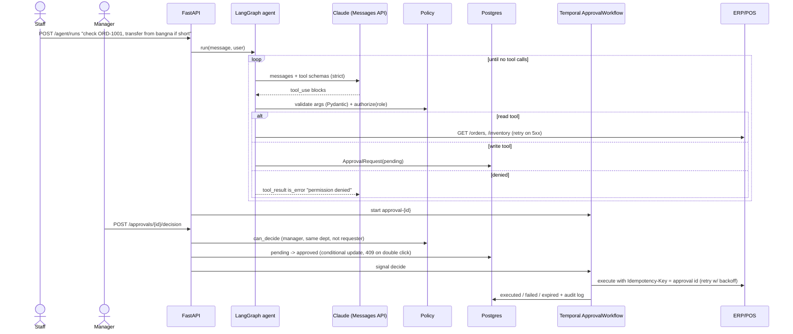
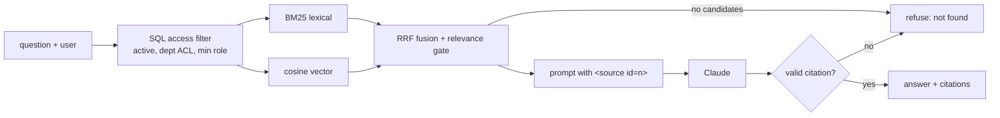

# OpsPilot — Enterprise AI Automation Platform

Portfolio project: an AI agent that works with ERP/POS systems **safely**. The LLM only proposes
changes; the backend enforces permissions, and a human approves every write before a durable
workflow executes it with retries and idempotency.

| Module | Status | What it does |
|---|---|---|
| **OpsPilot Agent** | built | AI agent on ERP/POS APIs with role policy and human approval |
| **OpsPilot Knowledge** | built | Permission-aware hybrid RAG over internal documents, with verified citations |
| **OpsPilot DocFlow** | planned | Invoice/receipt extraction, validation and review queue into the ERP |

All three share the same core (auth, audit, LLM client, workflows).

## Architecture



Key design choices:

| Concern | How |
|---|---|
| LLM never writes directly | Write tools become `ApprovalRequest` rows; only the workflow executes them |
| Permissions | `agent/policy.py` — role check per tool, approver rules (no self-approval, same department) |
| Tool input safety | Strict tool schemas + Pydantic validation before any call |
| Exactly-once writes | Conditional status transitions in DB + ERP `Idempotency-Key` = approval id |
| Long waits / crashes | Temporal workflow waits up to 24h for a decision, survives restarts, expires otherwise |
| Transient ERP failures | Client-side retry (tenacity) + Temporal activity retry; 4xx are permanent → `failed` |
| Audit / PDPA | Every tool call, request, decision and execution is in `audit_logs`; PII masked |
| Offline dev | `LLM_PROVIDER=fake` deterministic planner, `APPROVAL_BACKEND=inline` without Temporal |

## OpsPilot Knowledge



| Concern | How |
|---|---|
| No permission leaks | ACL rows (department or `*`) + minimum role, applied in the SQL `WHERE` **before** scoring, so forbidden chunks never reach ranking, prompts or citations. Admins get no read bypass. Same filter for `/knowledge/*` and the agent's `search_knowledge` tool |
| No existence leaks | Removing a document you cannot read returns 404, not 403 |
| Thai + English | Thai runs tokenised as character bigrams (no segmenter needed); English stopwords dropped |
| Hybrid ranking | BM25 + cosine fused with Reciprocal Rank Fusion; a relevance gate (query-term coverage or vector similarity) stops it from always returning *something* |
| Grounding | Model must cite `[n]` or reply `NO_ANSWER`; citations to sources we did not send are stripped, and an answer with no valid citation is replaced by a refusal |
| Prompt injection | Retrieved text is wrapped in `<source>` tags, HTML-escaped, and the system prompt says it is data |
| Versioning | Re-uploading a `source` with new content creates version n+1 and retires the old one; same content is a no-op (content hash) |
| Publishing rights | Managers publish only to their own department; company-wide (`*`) is admin only |
| Audit | Every ask logs retrieved and cited document ids (question PII-masked); ingest/removal logged |
| Embeddings | `hash` (offline, deterministic) or `voyage` (Voyage AI API) behind one `Embedder` protocol |

Seed documents with access front-matter live in `docs/knowledge/` (one is HR-manager-only salary data,
one is finance-only) and load at startup.

```bash
H="Authorization: Bearer $(curl -s localhost:8000/auth/dev-token -H 'content-type: application/json' \
  -d '{"user_id":"u1","role":"staff","department":"ops"}' | jq -r .access_token)"
curl -s localhost:8000/knowledge/ask -H "$H" -H 'content-type: application/json' \
  -d '{"question":"ลาพักร้อนได้กี่วันต่อปี"}' | jq
```

### Eval

`evals/knowledge_eval.py` runs 29 cases, each as a specific `role@department`, covering answerable,
off-topic and not-permitted questions. With the offline hashing embedder:

| hit@3 | MRR | grounded | wrong answer | correct refusal | ACL leaks |
|---|---|---|---|---|---|
| 0.95 | 0.95 | 0.95 | 0.05 | 1.00 | 0 |

The one miss is a cross-lingual case (Thai question, English document) that character n-grams
cannot bridge: the answerer cited the wrong document. A multilingual embedding model
(`EMBEDDING_PROVIDER=voyage`) is the fix to measure next. CI fails if ACL leaks > 0, correct refusal < 1.0 or hit@3 < 0.9.
The cases are small and the thresholds were tuned on the same documents, so treat these numbers as
a regression gate, not a quality claim.

## Layout

```
src/opspilot/
  core/        config, db models, JWT auth, audit (PII masking), LLM client (Anthropic SDK)
  agent/       tools, policy, LangGraph loop, ERP client, approvals state machine, fake LLM
  knowledge/   models + ACL, chunking, tokeniser, embeddings, hybrid retrieval, grounded answering
  worker/      Temporal ApprovalWorkflow + activities + worker entrypoint
  api/         FastAPI app, routes (agent runs, approvals, audit, dev auth), orchestrators
  mocks/erp_pos/  mock ERP/POS with idempotency + chaos knobs
docs/knowledge/  seed documents with access front-matter
evals/         knowledge retrieval/answer eval (cases + runner)
tests/         policy, ERP client, agent API, knowledge (ACL, citations, versioning), Temporal workflow
scripts/demo.sh  happy-path demo
```

## Run

Local, no Docker (fake LLM, inline approvals, SQLite):

```bash
uv sync
uv run uvicorn opspilot.mocks.erp_pos.app:app --port 8100 &
DATABASE_URL=sqlite+aiosqlite:///./dev.db APPROVAL_BACKEND=inline LLM_PROVIDER=fake \
  uv run uvicorn opspilot.api.main:app --port 8000
./scripts/demo.sh
```

Full stack (Postgres + Temporal + worker):

```bash
docker compose up --build
./scripts/demo.sh            # Temporal UI: http://localhost:8233
```

Use real Claude: set `LLM_PROVIDER=anthropic` and `ANTHROPIC_API_KEY` (model defaults to
`claude-opus-5-5`, effort `medium`, server-side refusal fallback on).

Chaos testing: `CHAOS_ERROR_RATE=0.3 CHAOS_LATENCY_MS=500 docker compose up erp-mock`.

## Test

```bash
uv run pytest -q     # first run downloads Temporal's test server (~1 min)
uv run ruff check .
uv run python evals/knowledge_eval.py
```

## Next

- Agent eval set (30–50 scenarios): tool-selection accuracy, task success, unauthorized-action rate
- Langfuse tracing on LLM calls and tool steps
- Alembic migrations instead of `create_all`
- Real IdP (OIDC) instead of `/auth/dev-token`
- Knowledge: push BM25/cosine into Postgres (pgvector `<=>`, `tsvector`) for large corpora; Thai word segmentation (PyThaiNLP); PDF/DOCX ingestion; reranker
- Project C: OpsPilot DocFlow
