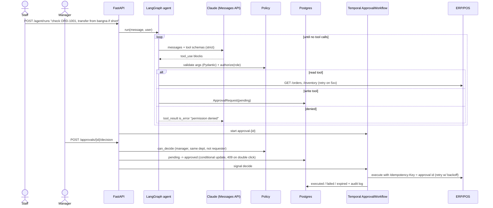

# Enterprise AI Automation Hub

Portfolio project: an AI agent that works with ERP/POS systems **safely**. The LLM only proposes
changes; the backend enforces permissions, and a human approves every write before a durable
workflow executes it with retries and idempotency.

This repo currently contains the **shared core** and **Project B — AI Agent + ERP/POS + Human Approval**.
Project A (Enterprise RAG) and Project C (Document AI) plug into the same core later.

## Architecture



Key design choices:

| Concern | How |
|---|---|
| LLM never writes directly | Write tools become `ApprovalRequest` rows; only the workflow executes them |
| Permissions | `agent/policy.py` — role check per tool, approver rules (no self-approval, same department) |
| Tool input safety | Strict tool schemas + Pydantic validation before any call |
| Exactly-once writes | Conditional status transitions in DB + ERP `Idempotency-Key` = approval id |
| Long waits / crashes | Temporal workflow waits up to 24h for a decision, survives restarts, expires otherwise |
| Transient ERP failures | Client-side retry (tenacity) + Temporal activity retry; 4xx are permanent → `failed` |
| Audit / PDPA | Every tool call, request, decision and execution is in `audit_logs`; PII masked |
| Offline dev | `LLM_PROVIDER=fake` deterministic planner, `APPROVAL_BACKEND=inline` without Temporal |

## Layout

```
src/aiw/
  core/        config, db models, JWT auth, audit (PII masking), LLM client (Anthropic SDK)
  agent/       tools, policy, LangGraph loop, ERP client, approvals state machine, SOP search, fake LLM
  worker/      Temporal ApprovalWorkflow + activities + worker entrypoint
  api/         FastAPI app, routes (agent runs, approvals, audit, dev auth), orchestrators
  mocks/erp_pos/  mock ERP/POS with idempotency + chaos knobs
docs/sop/      SOP documents the agent searches (placeholder for Project A RAG)
tests/         policy, ERP client, API end-to-end, Temporal workflow (time-skipping)
scripts/demo.sh  happy-path demo
```

## Run

Local, no Docker (fake LLM, inline approvals, SQLite):

```bash
uv sync
uv run uvicorn aiw.mocks.erp_pos.app:app --port 8100 &
DATABASE_URL=sqlite+aiosqlite:///./dev.db APPROVAL_BACKEND=inline LLM_PROVIDER=fake \
  uv run uvicorn aiw.api.main:app --port 8000
./scripts/demo.sh
```

Full stack (Postgres + Temporal + worker):

```bash
docker compose up --build
./scripts/demo.sh            # Temporal UI: http://localhost:8233
```

Use real Claude: set `LLM_PROVIDER=anthropic` and `ANTHROPIC_API_KEY` (model defaults to
`claude-opus-5-5`, effort `medium`, server-side refusal fallback on).

Chaos testing: `CHAOS_ERROR_RATE=0.3 CHAOS_LATENCY_MS=500 docker compose up erp-mock`.

## Test

```bash
uv run pytest -q     # first run downloads Temporal's test server (~1 min)
uv run ruff check .
```

## Next

- Agent eval set (30–50 scenarios): tool-selection accuracy, task success, unauthorized-action rate
- Langfuse tracing on LLM calls and tool steps
- Alembic migrations instead of `create_all`
- Real IdP (OIDC) instead of `/auth/dev-token`
- Project A: replace `SopIndex` with pgvector hybrid search + department ACL
