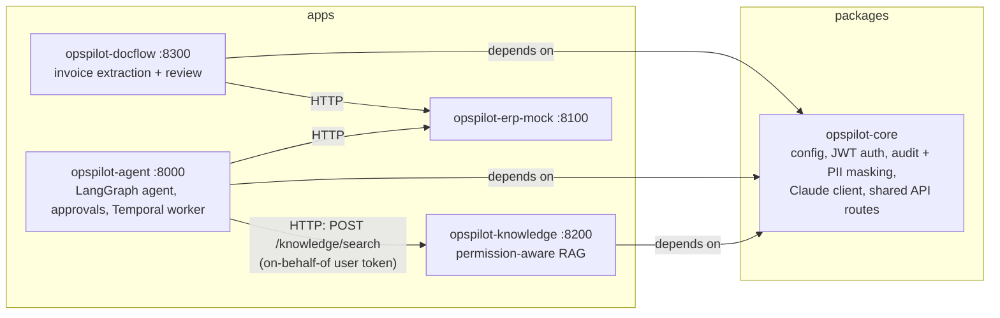
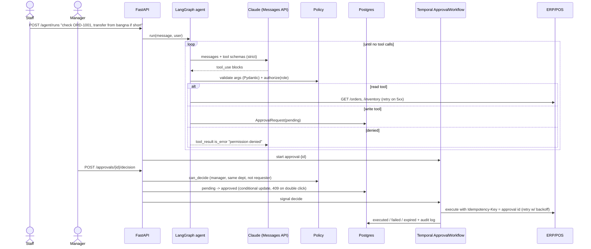
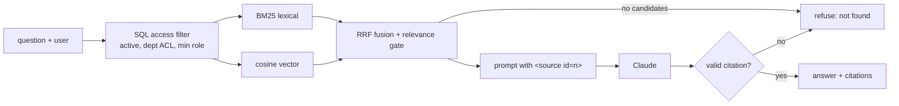
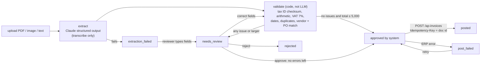

# OpsPilot — Enterprise AI Automation Platform

Portfolio project: an AI agent that works with ERP/POS systems **safely**. The LLM only proposes
changes; the backend enforces permissions, and a human approves every write before a durable
workflow executes it with retries and idempotency.

| Module | Status | What it does |
|---|---|---|
| **OpsPilot Agent** | built | AI agent on ERP/POS APIs with role policy and human approval |
| **OpsPilot Knowledge** | built | Permission-aware hybrid RAG over internal documents, with verified citations |
| **OpsPilot DocFlow** | built | Invoice/receipt extraction, deterministic validation, review queue and ERP posting |

A uv workspace monorepo: each module is its own package and service, and all of them build on
`opspilot-core`. Services talk to each other over HTTP only; a lint rule (`TID251`) fails the build
if one app imports another.



When the agent searches the knowledge base it mints a 2-minute token carrying the **user's** id,
role and department, so Knowledge applies that user's access filter. The agent can never read a
document the user could not open directly.

## Architecture



Key design choices:

| Concern | How |
|---|---|
| LLM never writes directly | Write tools become `ApprovalRequest` rows; only the workflow executes them |
| Permissions | `opspilot_agent/policy.py` — role check per tool, approver rules (no self-approval, same department) |
| Tool input safety | Strict tool schemas + Pydantic validation before any call |
| Exactly-once writes | Conditional status transitions in DB + ERP `Idempotency-Key` = approval id |
| Long waits / crashes | Temporal workflow waits up to 24h for a decision, survives restarts, expires otherwise |
| Transient ERP failures | Client-side retry (tenacity) + Temporal activity retry; 4xx are permanent → `failed` |
| Audit / PDPA | Every tool call, request, decision and execution is in `audit_logs`; PII masked |
| Offline dev | `LLM_PROVIDER=fake` deterministic planner, `APPROVAL_BACKEND=inline` without Temporal |

## OpsPilot Knowledge



| Concern | How |
|---|---|
| No permission leaks | ACL rows (department or `*`) + minimum role, applied in the SQL `WHERE` **before** scoring, so forbidden chunks never reach ranking, prompts or citations. Admins get no read bypass. Same filter for `/knowledge/*` and the agent's `search_knowledge` tool |
| No existence leaks | Removing a document you cannot read returns 404, not 403 |
| Thai + English | Thai runs tokenised as character bigrams (no segmenter needed); English stopwords dropped |
| Hybrid ranking | BM25 + cosine fused with Reciprocal Rank Fusion; a relevance gate (query-term coverage or vector similarity) stops it from always returning *something* |
| Grounding | Model must cite `[n]` or reply `NO_ANSWER`; citations to sources we did not send are stripped, and an answer with no valid citation is replaced by a refusal |
| Prompt injection | Retrieved text is wrapped in `<source>` tags, HTML-escaped, and the system prompt says it is data |
| Versioning | Re-uploading a `source` with new content creates version n+1 and retires the old one; same content is a no-op (content hash) |
| Publishing rights | Managers publish only to their own department; company-wide (`*`) is admin only |
| Audit | Every ask logs retrieved and cited document ids (question PII-masked); ingest/removal logged |
| Embeddings | `hash` (offline, deterministic) or `voyage` (Voyage AI API) behind one `Embedder` protocol |

Seed documents with access front-matter live in `apps/knowledge/seed/` (one is HR-manager-only salary data,
one is finance-only) and load at startup.

```bash
H="Authorization: Bearer $(curl -s localhost:8000/auth/dev-token -H 'content-type: application/json' \
  -d '{"user_id":"u1","role":"staff","department":"ops"}' | jq -r .access_token)"
curl -s localhost:8000/knowledge/ask -H "$H" -H 'content-type: application/json' \
  -d '{"question":"ลาพักร้อนได้กี่วันต่อปี"}' | jq
```

### Eval

`apps/knowledge/evals/knowledge_eval.py` runs 29 cases, each as a specific `role@department`, covering answerable,
off-topic and not-permitted questions. With the offline hashing embedder:

| hit@3 | MRR | grounded | wrong answer | correct refusal | ACL leaks |
|---|---|---|---|---|---|
| 0.95 | 0.95 | 0.95 | 0.05 | 1.00 | 0 |

The one miss is a cross-lingual case (Thai question, English document) that character n-grams
cannot bridge: the answerer cited the wrong document. A multilingual embedding model
(`EMBEDDING_PROVIDER=voyage`) is the fix to measure next. CI fails if ACL leaks > 0, correct refusal < 1.0 or hit@3 < 0.9.
The cases are small and the thresholds were tuned on the same documents, so treat these numbers as
a regression gate, not a quality claim.

## OpsPilot DocFlow



| Concern | How |
|---|---|
| LLM reads, code decides | Claude only transcribes into a strict JSON schema (structured outputs). The prompt forbids fixing numbers, so wrong totals on the paper stay visible to the validator |
| Validation | `validation.py` is a pure function: Thai tax ID mod-11 checksum, line/subtotal/VAT/total arithmetic (1 satang tolerance), date sanity, Buddhist-era years, duplicate invoice (ERP + in-flight documents), vendor master and PO match. Errors block approval; warnings need a human |
| Straight-through processing | Only documents with **zero** issues and a total ≤ `AUTO_POST_LIMIT` (5,000 THB) post without a reviewer |
| Four-eyes | Same rule as agent approvals, now shared in `opspilot_core.auth.approval_denied_reason`: manager of the department or admin, never the uploader. Denied attempts are audited |
| Corrections | Reviewer edits are re-validated from scratch; the audit log keeps before/after per field, and the original model output is kept, so corrections become eval data |
| Exactly-once posting | Conditional status updates (409 on double clicks) + ERP `Idempotency-Key` = document id; failed posts are retried from `post_failed` without creating a second AP invoice |
| ERP outages | Lookup failures become `*_unchecked` warnings (never a false "unknown vendor") and stop auto-posting |
| Prompt injection | The document is wrapped as data and the model has no tools; the worst it can do is mis-transcribe, which validation and review catch |
| Visibility | Staff see their uploads, managers their department, admins all; others get 404 |

```bash
H="Authorization: Bearer $(curl -s localhost:8300/auth/dev-token -H 'content-type: application/json' \
  -d '{"user_id":"u1","role":"staff","department":"ops"}' | jq -r .access_token)"
curl -s localhost:8300/docflow/documents -H "$H" -F "file=@apps/docflow/samples/siam-coffee-bad-math.txt;type=text/plain" | jq '.status, .issues'
```

### Eval

`apps/docflow/evals/docflow_eval.py` uploads each sample through the API and scores field accuracy,
issue recall, false issues on clean documents, routing (posted vs review) and unsafe auto-posts
(must be 0). With the offline text extractor all five cases pass. That checks parsing, validation
and routing, **not** Claude's reading of real scans: the samples are text files. To measure
extraction quality, add scanned PDFs/photos with ground truth to `cases.jsonl` and run with
`LLM_PROVIDER=anthropic`.

## Layout

```
pyproject.toml               workspace root: members, dev tools, ruff + pytest config
packages/core/               opspilot-core: config, DB base + audit table, JWT auth, audit (PII masking),
                             Claude client, shared FastAPI deps/routes (/health, /auth/dev-token, /audit)
apps/agent/                  opspilot-agent
  src/opspilot_agent/        tools, policy, LangGraph loop, ERP + Knowledge clients, approvals, fake LLM
    api/                     FastAPI app, agent-run and approval routes, orchestrators
    worker/                  Temporal ApprovalWorkflow + activities + worker entrypoint
  tests/                     policy, ERP client, agent API, Temporal workflow, Agent->Knowledge over HTTP
apps/knowledge/              opspilot-knowledge
  src/opspilot_knowledge/    models + ACL, chunking, tokeniser, embeddings, retrieval, grounded answers, API
  seed/                      seed documents with access front-matter
  evals/                     retrieval/answer eval (cases + runner)
  tests/                     ACL, citations, versioning, publishing rights, eval gate
apps/docflow/                opspilot-docflow
  src/opspilot_docflow/      schema, extractors (Claude + offline), validation, lifecycle service, API
  samples/                   sample invoices/receipts (clean, bad math, bad tax ID, not an invoice)
  evals/                     end-to-end extraction/validation/routing eval
  tests/                     validation rules, extractor requests, API lifecycle, eval gate
apps/erp-mock/               opspilot-erp-mock: orders, inventory, vendors, POs, AP invoices; idempotency + chaos
scripts/demo.sh              happy-path demo
```

Add a module: create `apps/<name>/` with its own `pyproject.toml` depending on
`opspilot-core`, a `ruff.toml` that bans importing the other apps, and a service entry in
`docker-compose.yml`. The workspace picks it up through `members = ["packages/*", "apps/*"]`.

## Run

Local, no Docker (fake LLM, inline approvals, SQLite):

```bash
uv sync
uv run uvicorn opspilot_erp_mock.app:app --port 8100 &
DATABASE_URL=sqlite+aiosqlite:///./knowledge.db uv run uvicorn opspilot_knowledge.main:app --port 8200 &
DATABASE_URL=sqlite+aiosqlite:///./docflow.db uv run uvicorn opspilot_docflow.main:app --port 8300 &
DATABASE_URL=sqlite+aiosqlite:///./agent.db APPROVAL_BACKEND=inline \
  uv run uvicorn opspilot_agent.api.main:app --port 8000
./scripts/demo.sh
```

Full stack (Postgres + Temporal + worker + all services):

```bash
docker compose up --build
./scripts/demo.sh            # Temporal UI: http://localhost:8233
```

One `Dockerfile` builds any member: `docker build --build-arg PACKAGE=opspilot-knowledge .`
installs only that package and its dependencies.

Use real Claude: set `LLM_PROVIDER=anthropic` and `ANTHROPIC_API_KEY` (model defaults to
`claude-opus-5-5`, effort `medium`, server-side refusal fallback on).

Chaos testing: `CHAOS_ERROR_RATE=0.3 CHAOS_LATENCY_MS=500 docker compose up erp-mock`.

## Test

```bash
uv run pytest -q                                  # whole workspace; first run downloads Temporal's test server
uv run pytest -q apps/knowledge                   # one package
uv run ruff check . && uv run ruff format --check .
uv run python apps/knowledge/evals/knowledge_eval.py
uv run python apps/docflow/evals/docflow_eval.py
```

## Next

- Agent eval set (30–50 scenarios): tool-selection accuracy, task success, unauthorized-action rate
- Langfuse tracing on LLM calls and tool steps
- Alembic migrations instead of `create_all`
- Real IdP (OIDC + JWKS) instead of `/auth/dev-token` and the shared HS256 secret
- Knowledge: push BM25/cosine into Postgres (pgvector `<=>`, `tsvector`) for large corpora; Thai word segmentation (PyThaiNLP); PDF/DOCX ingestion; reranker
- DocFlow: async extraction queue (Temporal) for large batches; object storage instead of DB blobs; 3-way match with goods receipts; scanned-PDF eval set for Claude
