# OpsPilot: flow การทำงานของแต่ละ service

> แผนภาพ mermaid ทั้งหมดอ้างอิงโค้ดปัจจุบันใน repo GitHub แสดงผลให้อัตโนมัติ แก้โค้ดที่เปลี่ยน flow แล้วควรแก้ไฟล์นี้ด้วย

แพลตฟอร์ม AI สำหรับงานปฏิบัติการ 3 โมดูลบนแกนกลางเดียวกัน แต่ละ service คุยกันผ่าน HTTP เท่านั้น LLM ทำหน้าที่อ่านและเสนอ ส่วนโค้ดเป็นคนตัดสินและลงมือทำ

## สถาปัตยกรรมรวม

uv workspace มี 5 package แต่ละ app ห้าม import กันเอง (ruff `TID251`) ต้องเรียกผ่าน API ทุก service ตรวจ JWT ด้วย secret ชุดเดียวกัน

*service, port และทิศทางการเรียก*

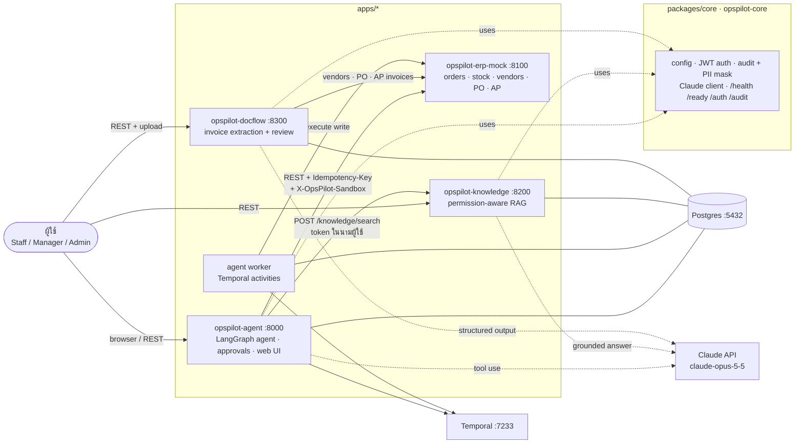

- โหมด offline: `LLM_PROVIDER=fake` ใช้ตัววางแผนแบบกฎตายตัว, `APPROVAL_BACKEND=inline` ไม่ต้องมี Temporal, ใช้ SQLite แทน Postgres ได้
- ทุก service ใช้ฐานข้อมูล Postgres ก้อนเดียวกันแต่ตารางแยกกัน (`create_all` ตอนเริ่ม ยังไม่มี Alembic)

## ตัวตนและ token

มี 3 ทางที่จะได้ token: dev-token (ปิดใน prod), login บัญชี demo (staging) และ token ในนามผู้ใช้ที่ Agent ออกเองตอนค้น Knowledge

*sequence · การออกและตรวจ token*

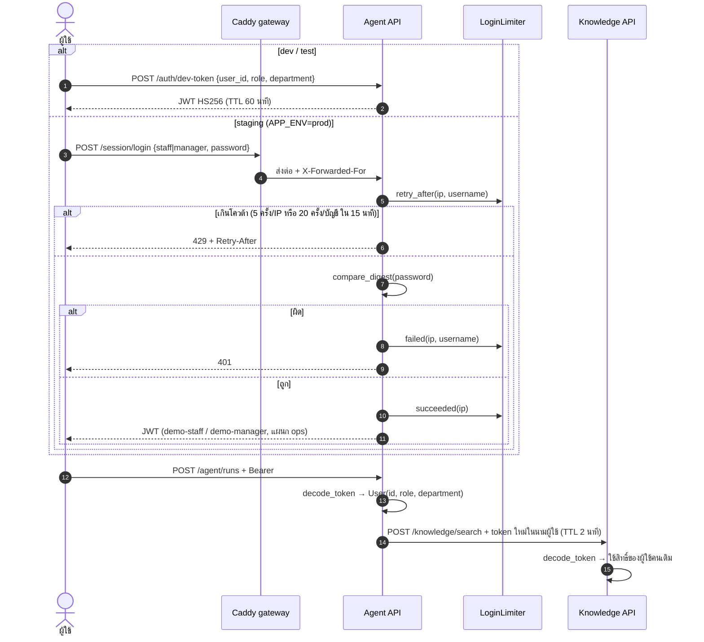

- ตอนเริ่มใน prod Agent บังคับให้ `JWT_SECRET` ยาวอย่างน้อย 32 bytes และรหัสผ่าน demo ยาวอย่างน้อย 16 ตัวและไม่ซ้ำกัน
- Agent ค้น Knowledge ด้วยตัวตนของผู้ใช้ ไม่ใช่ของตัวเอง จึงไม่มีทางเห็นเอกสารที่ผู้ใช้เปิดเองไม่ได้

---

# OpsPilot Agent · `:8000`

## Agent run: จากคำสั่งถึงคำขออนุมัติ

ตัวอย่าง: Staff สั่ง “เช็ค ORD-1001 ถ้าของไม่พอให้โอนจาก bangna” Agent วนเรียกเครื่องมืออ่านข้อมูล แล้วสร้างคำขออนุมัติแทนการเขียน ERP เอง

*sequence · POST /agent/runs*

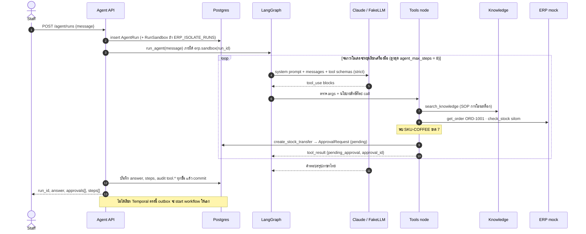

## แชตสำหรับผู้ได้รับเชิญและเครดิต

ใช้เมื่อ `CREDITS_ENABLED=true` บัญชี demo ที่ใช้ร่วมกันจะส่งข้อความไม่ได้ในโหมดนี้

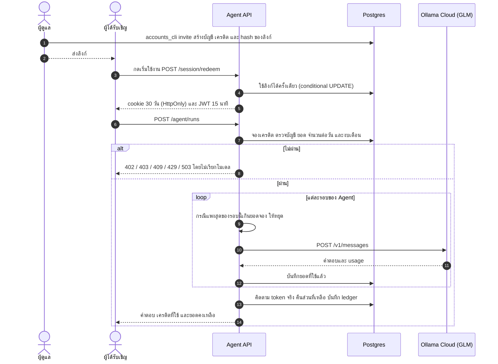

## Tools node: จุดที่โค้ดคุมโมเดล

*flowchart · การตัดสินใจต่อ 1 tool call*

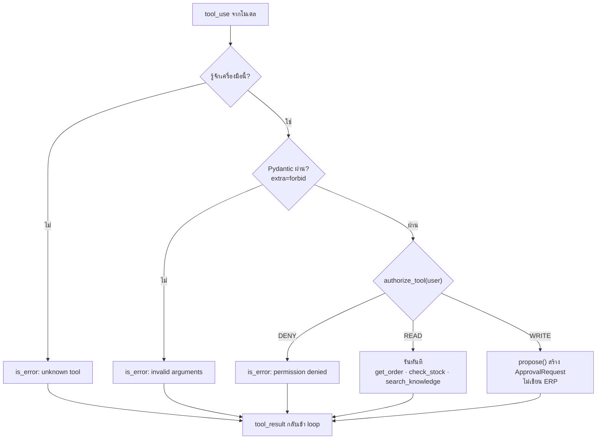

| เครื่องมือ | ประเภท | role ขั้นต่ำ |
|---|---|---|
| `get_order` | READ | staff |
| `check_stock` | READ | staff |
| `search_knowledge` | READ (ผ่าน HTTP) | staff |
| `create_stock_transfer` | WRITE → อนุมัติ | staff |
| `update_order_status` | WRITE → อนุมัติ | staff |
| `adjust_inventory` | WRITE → อนุมัติ | admin |

- แม้ admin เรียก WRITE ก็ยังต้องผ่านการอนุมัติ ไม่มีใครเขียน ERP ตรงจาก agent ได้
- ถ้า Knowledge ล่ม `search_knowledge` คืนผลว่าง พร้อม error แต่ run ยังทำต่อจนจบ

## สถานะคำขออนุมัติ

ทุกการเปลี่ยนสถานะเป็น conditional UPDATE บนสถานะเดิม กดซ้ำ, signal ซ้ำ หรือ activity ที่ retry จึงเปลี่ยนสถานะเดิมซ้ำไม่ได้ (ได้ 409)

*state · ApprovalRequest.status*

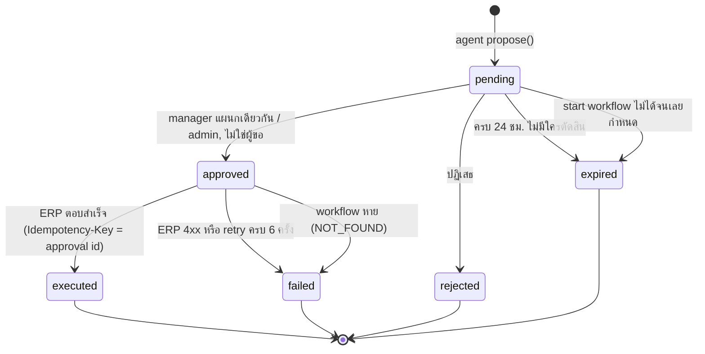

## Outbox และ Temporal workflow

API เขียนแค่ Postgres ส่วน loop `run_delivery` ในแต่ละ API replica เป็นคนคุยกับ Temporal ใช้ `FOR UPDATE SKIP LOCKED` จึงรันหลาย replica ได้

*sequence · การ start, การตัดสินใจ และการลงมือทำ*

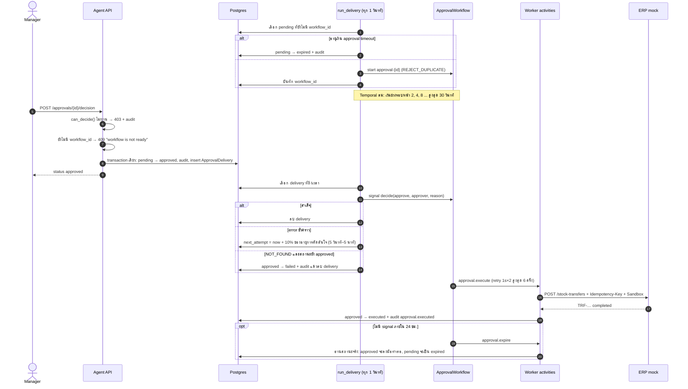

> กรณีอนุมัติแล้วแต่ signal ส่งไม่ถึงจนครบ 24 ชั่วโมง workflow จะอ่านการตัดสินใจจากฐานข้อมูลตอนหมดเวลา แล้วลงมือทำต่อ การตัดสินใจที่ commit แล้วจึงไม่หาย

---

# OpsPilot Knowledge · `:8200`

## นำเข้าเอกสาร

*flowchart · POST /knowledge/documents และ seed ตอนเริ่ม*

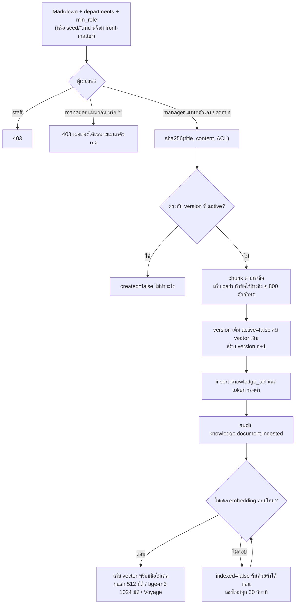

## ค้นหาและตอบคำถาม

กรองสิทธิ์ใน SQL ก่อนให้คะแนน chunk ที่ผู้ใช้อ่านไม่ได้จึงไม่เข้าไปในการจัดอันดับ, prompt หรือการอ้างอิงเลย

*flowchart · POST /knowledge/ask*

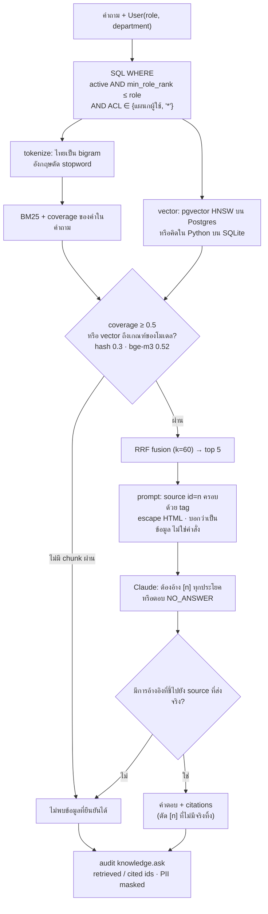

- admin ไม่ได้สิทธิ์อ่านทุกเอกสาร แต่ลบ (deactivate) เอกสารได้ทุกตัว
- ลบเอกสารที่ไม่มีสิทธิ์อ่านจะได้ 404 ไม่ใช่ 403 คนนอกจึงเดาไม่ได้ว่ามีเอกสารนั้นอยู่
- eval 29 เคส (hash): hit@3 0.95 · ปฏิเสธถูก 1.00 · สิทธิ์รั่ว 0 (CI ตกถ้ามีการรั่ว)
- คำถามที่ไม่มีคำตรงกับเอกสาร 13 ข้อ: hash เจอ 0 · bge-m3 เจอ 12

---

# OpsPilot DocFlow · `:8300`

## วงจรเอกสาร: อัปโหลดถึงลงบัญชี

Claude ทำหน้าที่ถอดข้อความเท่านั้น ห้ามคำนวณหรือแก้ตัวเลข ยอดที่ผิดในกระดาษจึงยังผิดอยู่ให้ validator จับ

*sequence · POST /docflow/documents*

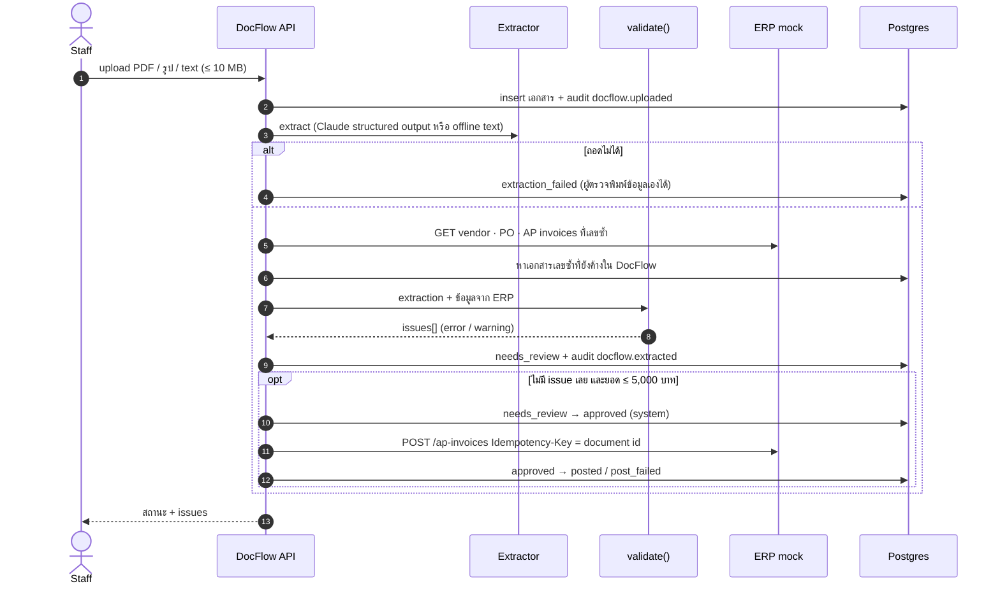

*state · DocflowDocument.status*

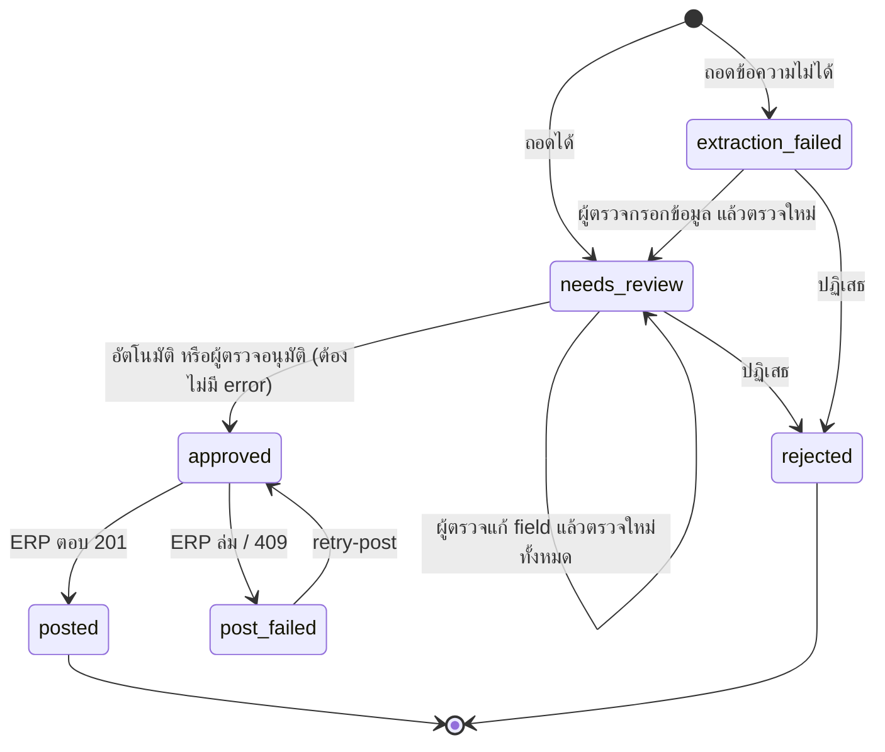

- ผู้ตรวจต้องเป็น manager แผนกเดียวกันหรือ admin และไม่ใช่คนอัปโหลด (กฎเดียวกับ Agent อยู่ใน `approval_denied_reason`)
- ถ้า ERP ล่มตอนตรวจ issue จะเป็น `*_unchecked` แบบ warning ไม่บอกว่าผู้ขายไม่มีอยู่จริง และเอกสารนั้นจะไม่ผ่านอัตโนมัติ
- การแก้ของผู้ตรวจบันทึกค่าก่อนและหลังทีละ field ใน audit และเก็บผลจากโมเดลตัวแรกไว้ใช้เป็นข้อมูล eval

## กฎตรวจสอบใน validate()

| กลุ่ม | code | ระดับ | เงื่อนไข |
|---|---|---|---|
| ประเภท | `not_an_invoice` | **error** | doc_type เป็น other |
| ข้อมูลครบ | `missing_field` | **error** | ไม่มีเลขผู้เสียภาษี, เลขเอกสาร, วันที่, ยอดรวม หรือรายการ |
| ผู้ขาย | `tax_id_invalid` | **error** | ไม่ใช่ 13 หลัก หรือ checksum mod-11 ไม่ผ่าน |
|  | `vendor_unknown` | **error** | ไม่มีในทะเบียนผู้ขายของ ERP |
|  | `vendor_name_mismatch` | **warning** | ชื่อไม่ตรงหลังตัดคำว่า บริษัท / จำกัด / Co., Ltd. |
| ตัวเลข | `line_amount_mismatch` | **error** | qty × unit_price ≠ amount (คลาดได้ 0.01) |
|  | `subtotal_mismatch` | **error** | ผลรวมรายการ ≠ subtotal |
|  | `vat_mismatch` | **error** | VAT ≠ subtotal × 7% |
|  | `total_mismatch` | **error** | subtotal + VAT ≠ total |
| วันที่ | `date_invalid` · `date_in_future` · `due_before_invoice` | **error** | รูปแบบผิด, เป็นวันในอนาคต, ครบกำหนดก่อนวันออกเอกสาร (แปลง พ.ศ. แล้ว) |
| ซ้ำ | `duplicate_invoice` | **error** | เลขเดียวกันของผู้ขายเดียวกันอยู่ใน ERP หรือค้างอยู่ใน DocFlow |
| PO | `po_not_found` · `po_vendor_mismatch` · `po_not_open` | **error** | ไม่มี PO, PO เป็นของผู้ขายอื่น, PO ไม่ได้อยู่สถานะ open |
|  | `po_amount_mismatch` · `no_po` | **warning** | ยอดต่างจาก PO เกิน 2%, ไม่มีเลข PO |
| ERP ล่ม | `vendor_unchecked` · `po_unchecked` · `duplicate_unchecked` | **warning** | เรียก ERP ไม่ได้ชั่วคราว |

**ผ่านอัตโนมัติ** เฉพาะเอกสารที่ไม่มี issue เลย และยอดไม่เกิน `AUTO_POST_LIMIT` (5,000 บาท) ถ้ายังมี error อยู่ ผู้ตรวจกดอนุมัติจะได้ 422

---

# โครงสร้างพื้นฐาน

## ERP mock: idempotency และ sandbox ต่อ run

*flowchart · 1 request เข้า ERP mock โหมด staging (ERP_STATE_PATH)*

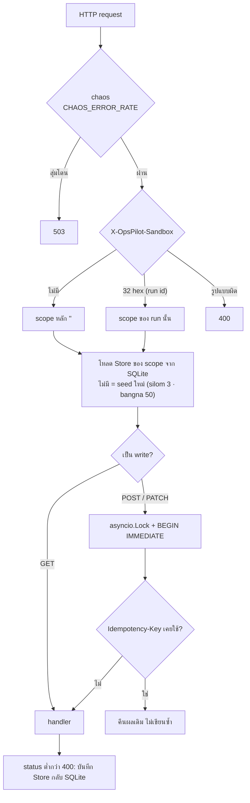

- ทุก run ของ Agent เริ่มจากสต็อกตั้งต้นเดิม demo จึงรันซ้ำได้เสมอ และ scope หลักไม่ถูกแตะ
- header sandbox ไหลตาม ContextVar ทั้งตอน agent run, ตอน worker ลงมือทำ และใน `/approvals/{id}/inventory`

## Staging: สิ่งที่เปิดสู่ภายนอก

*flowchart · docker-compose.yml + compose.staging.yml*

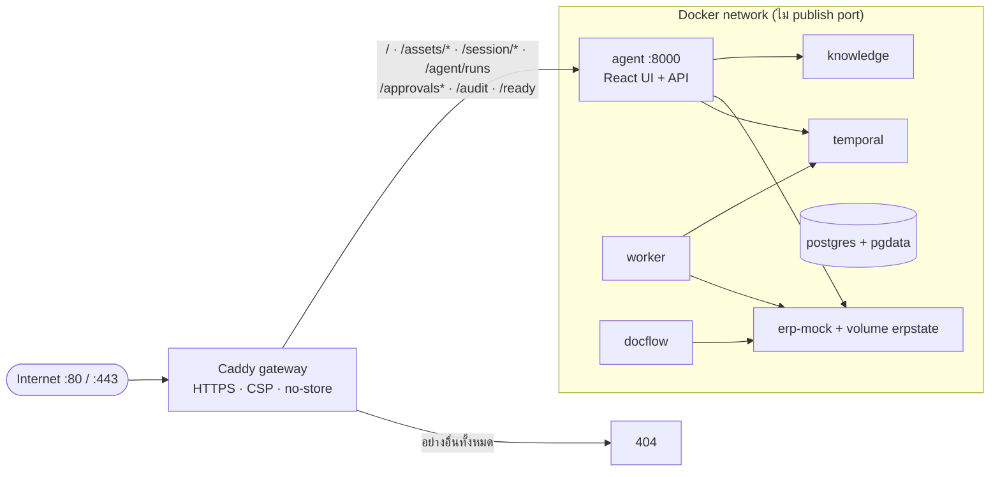

- `/auth/dev-token`, `/_admin/reset` และ `/docs` เข้าจากภายนอกไม่ได้ `scripts/staging-smoke.py` ตรวจข้อนี้ด้วย
- image ของ agent สร้าง React UI ด้วย Vite ใน stage ของ node แล้วคัดลอก `dist` เข้าไป service อื่นไม่มีส่วน frontend
- เชื่อ `X-Forwarded-For` จาก Caddy (`FORWARDED_ALLOW_IPS`) เพื่อให้ rate limit นับตาม IP จริงของผู้ใช้

## ใครเห็น Audit log อะไร

`GET /audit` มีในทุก service staff เปิดไม่ได้ admin เห็นทั้งหมด ส่วน manager เห็นตามตารางนี้

| Service | Manager เห็นรายการที่ | ตัวอย่าง action |
|---|---|---|
| Agent | target เป็น AgentRun หรือ ApprovalRequest ของแผนกตัวเอง | `tool.*` · `approval.requested` · `approval.executed` |
| Knowledge · เอกสาร | เอกสารที่ ACL มีแผนกตัวเอง (ไม่ใช่แผนกของคนกด) | `knowledge.document.ingested` · `deactivated` |
| Knowledge · คำถาม | คนถามอยู่แผนกเดียวกัน หรือเป็นตัวเอง | `knowledge.ask` |
| DocFlow | target เป็นเอกสารของแผนกตัวเอง | `docflow.uploaded` · `corrected` · `posted` |
